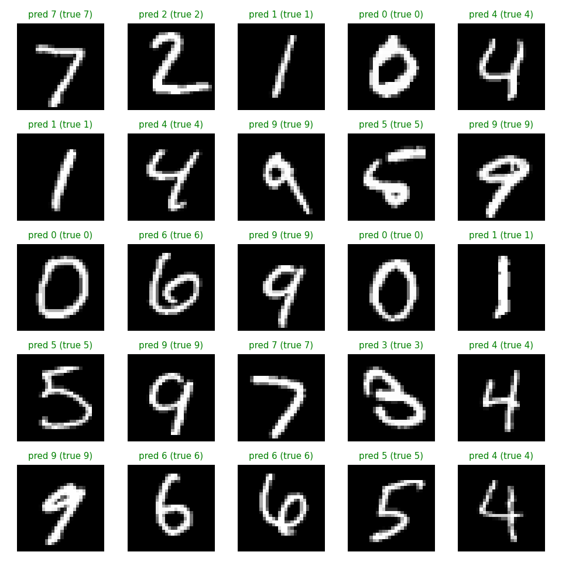
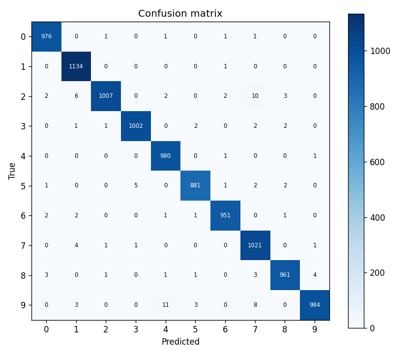

# Handwritten Digit Recognition

A beginner ML project: a small convolutional neural network (CNN) trained on the
[MNIST](http://yann.lecun.com/exdb/mnist/) dataset to recognize handwritten digits 0-9.

**Test accuracy: ~99%**



## Setup
```bash
python3 -m venv venv
source venv/bin/activate
pip install -r requirements.txt
```

## Train
```bash
python train.py
```
Trains for 5 epochs, prints test accuracy, and saves `model.keras`,
`predictions.png` and `confusion_matrix.png`.

## Predict on your own image
```bash
python predict.py sample_digit.png
```
Use a single digit image (e.g. drawn in Paint). It is converted to 28x28 grayscale
and inverted automatically if it has a light background.

## Model
Conv2D(32) -> MaxPool -> Conv2D(64) -> MaxPool -> Flatten -> Dropout(0.3) -> Dense(10, softmax)

## Results


## Tech
Python, TensorFlow/Keras, NumPy, Matplotlib, Pillow
